> **Plain-English Household Guide:** See [docs/USER_GUIDE.md](docs/USER_GUIDE.md) for easy setup and everyday button mapping without phone or voice reliance.

# Mi-Light Visual Remote & Panel Studio for Home Assistant

<!-- VISUAL_SHOWCASE_START -->
## Visual Walkthrough & Feature Guide

### 1. Single-Frame Visual Button Mapper & Interactive Peel-Back Stencil X-Ray
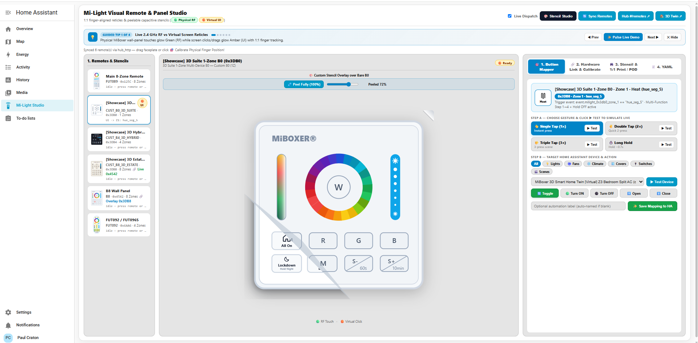
* **Zero-YAML Visual Mapping Cockpit:** Click any physical button, zone pad, or segmented touch-ring/slider slot on the center faceplate to preview its live keycap icon and bind **`👆 1× Single Tap`**, **`✌️ 2× Double Tap`**, **`🤟 3× Triple Tap`**, or **`⏱️ Long Hold`** gestures directly to Home Assistant Lights, Fans, Climate, Covers, Switches, or Scenes. Each gesture card includes an instant **`▶ Test`** simulator, while optional raw YAML stays neatly tucked inside Tab 4 (`4. YAML`).
* **Interactive Diagonal Peel-Back X-Ray:** Drag the **Peel Back Stencil** slider (shown here at `72%` on `0x3DB0`) to curl back your custom architectural decal and inspect the factory MiBoxer glass touch surface underneath while keeping **🟢 Physical 2.4 GHz RF** and **🟠 Virtual UI** finger reticles synchronized in real time.

### 2. Fullscreen Capacitive Stencil Studio & Single-Button Multi-Function Macros
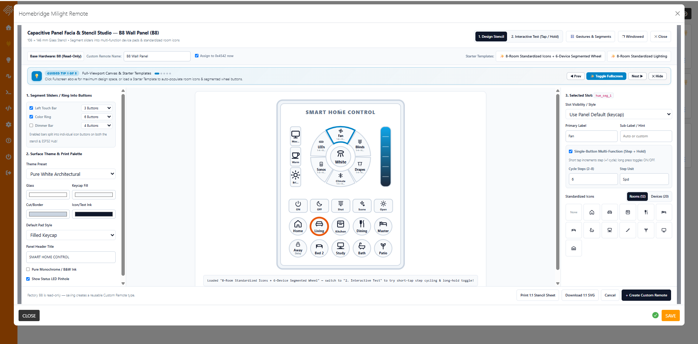
* **Turn Continuous Touch Wheels & Sliders Into Labeled Room & Device Keycaps:** Divide continuous color rings (`2–8` slices) and brightness/CCT/saturation touch bars (`2–6` slots) into discrete debounced buttons across 32 standardized room and appliance vector icons, architectural vinyl palettes (`Pure White`, `Warm Travertine`, `Matte Black`), and `Blank Masked` hiding for unused pads.
* **Step-Cycle + Long-Hold Toggle on One Button:** Enable **Single-Button Multi-Function** (e.g., `Fan 1→6 Spd`) so short taps step through fan speeds, blind positions, or AC modes while a `0.6s` hold toggles power `OFF`.

### 3. Native ESP32 Dual-Radio Hub Registry & Multi-Tap Surface Sync
| ESP32 Hub Native `#/remotes` Studio (`52%` Peel-Back) | Multi-Tap & Segmented Wheel Configurator |
| :---: | :---: |
| 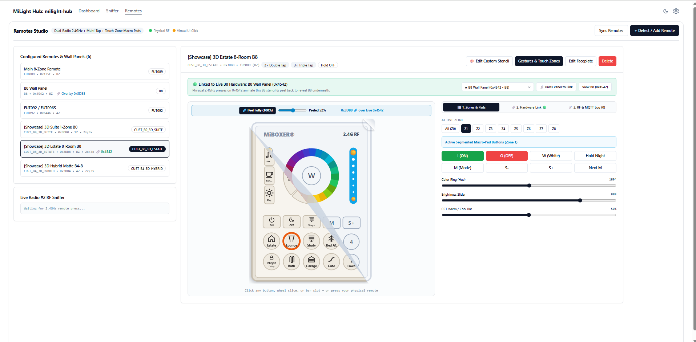 | 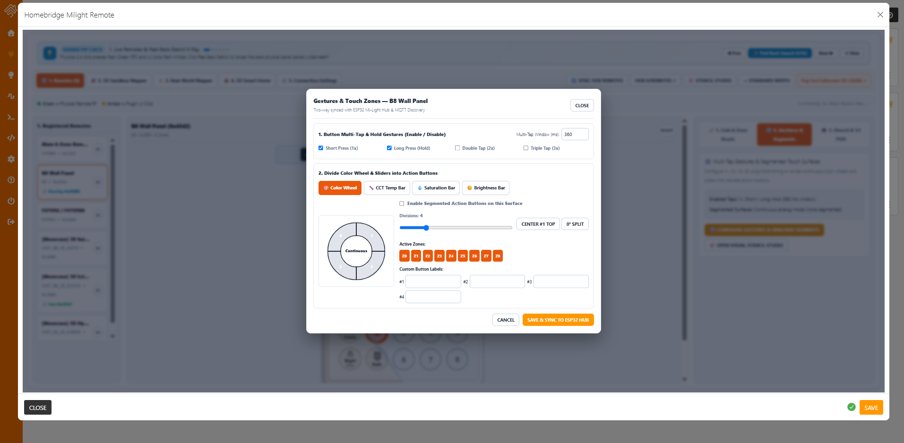 |
| Two-way synced with the ESP32 Mi-Light Hub (`#/remotes`): strict base-shell pairing links custom stencils (`0x3DB8` Estate B8) exclusively to matching physical panels (`0x4542` B8) over live 2.4 GHz RF. | Configure multi-tap debounce windows (`360 ms`), angular wheel splits (`Center #1 Top` or `0° Split`), and active zone masks (`Z0–Z8`) exposed automatically to Home Assistant via MQTT Discovery. |

### 4. Interactive 3D Smart Home Digital Twin (`:8588`) & Calibrated `1:1` Print Sheet
| Fullscreen 3D Smart Home with Hero Remote Dock | `1:1` Millimeter Print Sheet (`10 mm` Scale Check) |
| :---: | :---: |
| 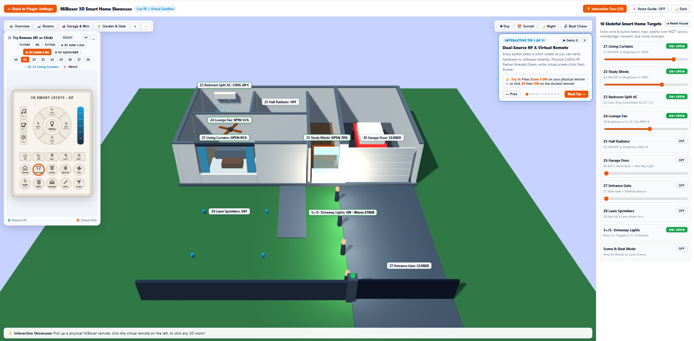 | 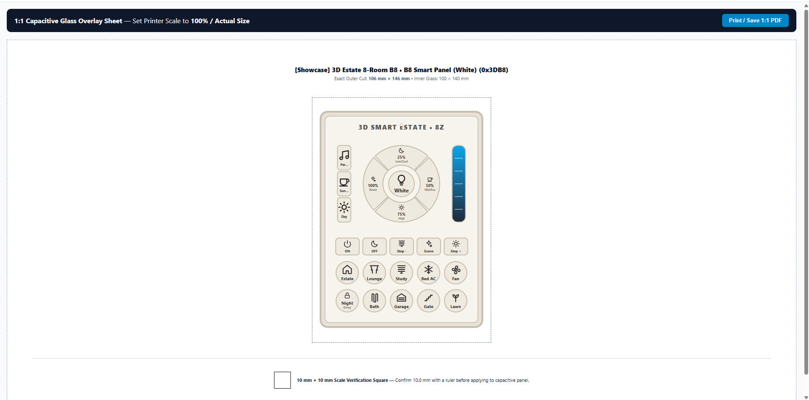 |
| Test physical 2.4 GHz wall panels and virtual multi-function stencils live against 10 animated smart-home targets (curtains, blinds, split AC, ceiling fan, garage door, sliding gate & sprinklers) with a 12-step Guided Tour. | Exports true physical-millimeter vector SVGs (`86 × 86 mm` square, `106 × 146 mm` B8 portrait, `70 × 114 mm` US single-gang) with a **`10 mm × 10 mm` verification square** and Print-on-Demand (`POD`) JSON payload. |
<!-- VISUAL_SHOWCASE_END -->

Interactive 1:1 visual remote configurator, capacitive wall-panel stencil studio, and MQTT/RF automation mapper for **esp8266_milight_hub** (ESP32 Dual-Radio & Remotes Studio).

## Key Features
- **61+ MiBoxer / Mi-Light 1:1 Vector Faceplates** synchronized directly from the ESP32 Hub single source of truth (`miboxer_catalog.js` & `remote_studio.js`).
- **Two-Way Live Hardware Panel Linking:** Link virtual custom stencils (e.g. `CUST_B8_3D_ESTATE`) to live detected physical wall panels (e.g. `B8 0x4542`) so physical 2.4 GHz RF touches animate segmented wheel slices and slider macro buttons in real time.
- **Capacitive Panel Facia & 1:1 Printable Stencil Studio:** Segment color wheels and sliders into labeled room/device pads with automatic box-aware icon/text autofit and calibrated 1:1 millimeter print export (`SVG` / print sheet / POD JSON).
- **One-Click Home Assistant Automation Builder:** Bind single-tap, double-tap, triple-tap, long-hold, and segmented wheel/bar actions directly to Home Assistant entities.
- **Live Finger-Position Reticles & Calibration Wizard:** Color-coded physical RF (emerald) vs. virtual UI (amber) pucks across wheels, saturation/CCT bars, and dimmers.

## Installation (HACS Custom Repository)
1. Open **HACS → Integrations → ⋮ (Top Right) → Custom repositories**.
2. Add `https://github.com/pauleec/ha-milight-remote-studio` with category **Integration**.
3. Install **Mi-Light Visual Remote & Panel Studio** and restart Home Assistant.

## Nighttime Strontium Aluminate Luminous Remote Preview & 1:1 Cut Sheets

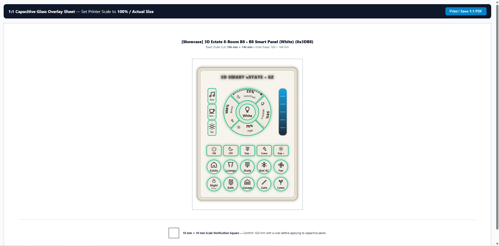

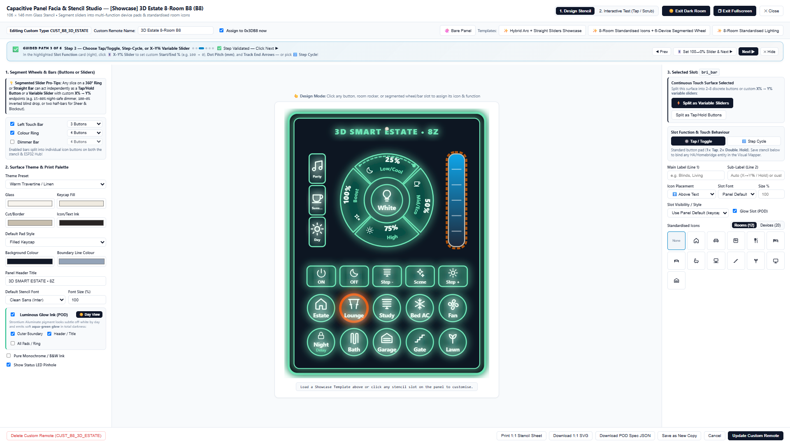

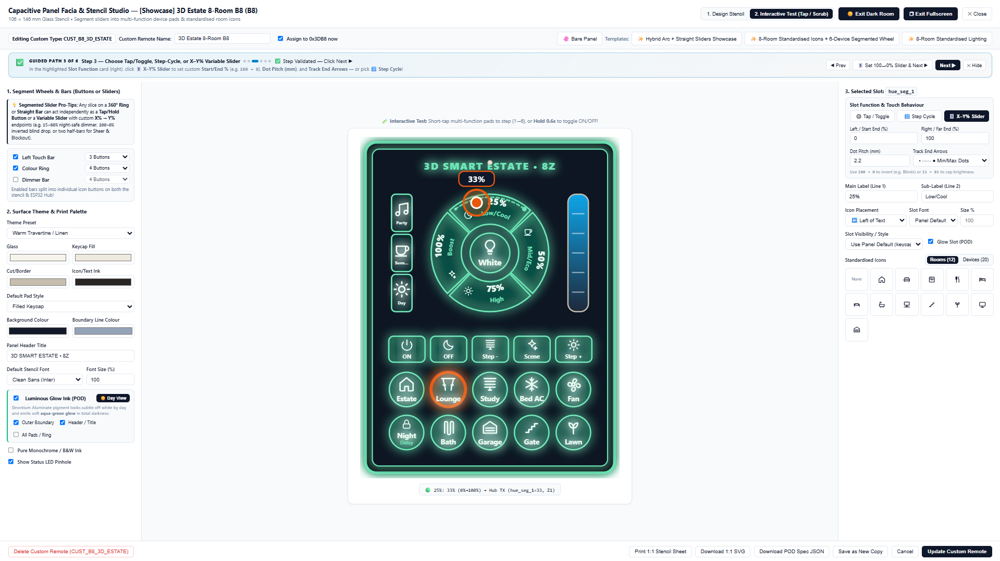

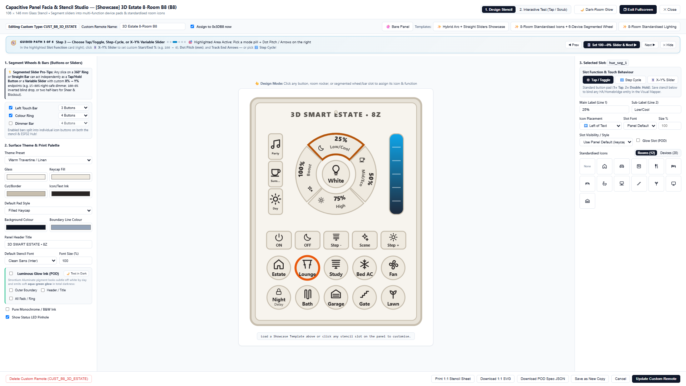

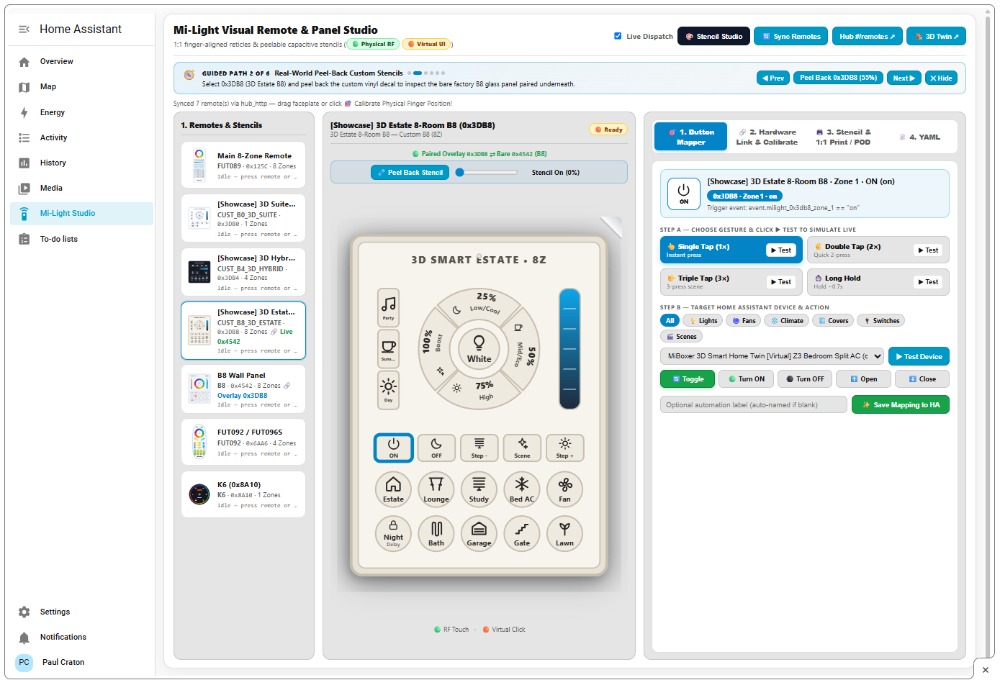

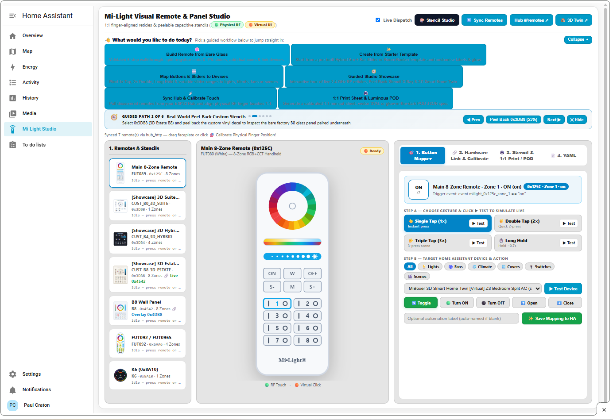
